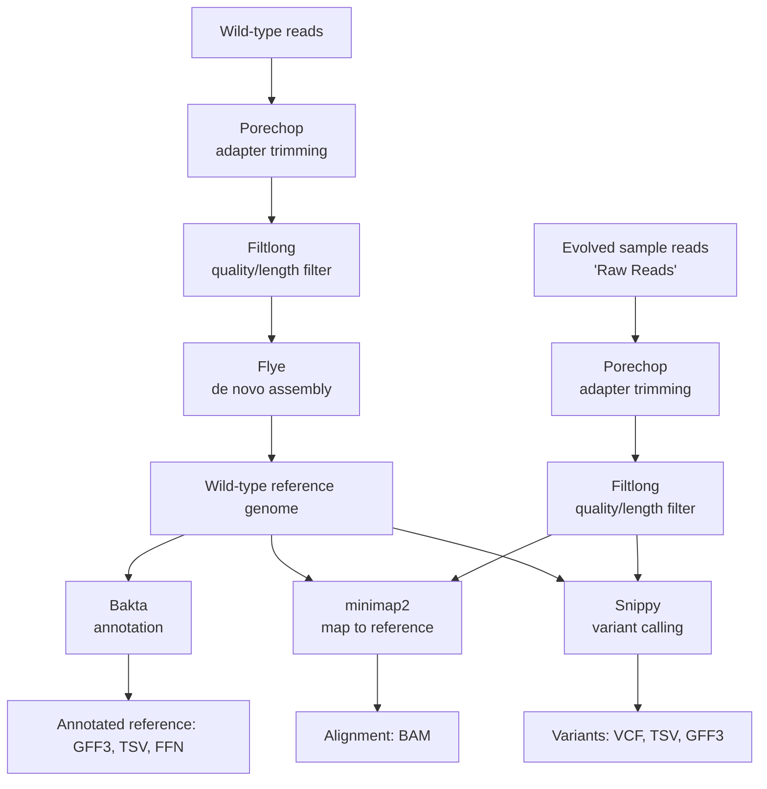

# ssp-bacgenpipeline

A Galaxy workflow that finds antibiotic-resistance mutations in *Vibrio natriegens* from Oxford Nanopore reads. It builds a de novo reference genome from wild-type reads, annotates it, and calls variants in an evolved (erythromycin-exposed) sample against that reference.

The exported workflow is in [`galaxy/Galaxy-Workflow-DE_NOVO_WORKFLOW.ga`](galaxy/Galaxy-Workflow-DE_NOVO_WORKFLOW.ga).

> **Status:** The Galaxy version is complete. A command-line reimplementation in Snakemake is planned (see [Roadmap](#roadmap)).

## Project background

Rising antibiotic resistance is a major global public health concern, driven in part by heavy antibiotic use in livestock production and healthcare. Resistance arises when mutations in a bacterial genome let some cells survive higher antibiotic doses.

To study how this evolves, *V. natriegens* cultures were grown in a morbidostat, a device that adjusts erythromycin concentration according to the bacteria's growth rate while keeping population density stable. Samples were collected as cultures recovered from increased antibiotic doses, which is when resistance-related mutations are likely to have arisen. DNA from these samples was sequenced with Oxford Nanopore and compared against a de novo reference genome to find mutations that may confer resistance.

Mutations were observed in genes encoding an LTTR-family regulator, an AraC-family regulator, an ABC transporter, and long-chain fatty-acid CoA ligase (LCFA-CoA ligase). This repository contains the bioinformatics workflow used to process the reads and call these variants.

## Overview

**Question:** What mutations does the evolved *V. natriegens* sample carry compared with the wild-type genome, and which genes do they affect?

**Approach:**
1. Trim adapters and filter both read sets (evolved sample and wild type).
2. Assemble the wild-type reads into a de novo reference genome.
3. Annotate the reference to identify genes.
4. Call variants by comparing the evolved sample's reads against the reference.

## Workflow diagram



## Inputs

| Input | Description |
|---|---|
| Raw Reads | Nanopore reads (FASTQ) from the evolved sample |
| Wild-Type | Nanopore reads (FASTQ) from the wild-type strain, used to build the reference |

[EDIT: add where the reads came from, such as SRA accessions or "provided by the course", and which morbidostat sample the "Raw Reads" input was.]

No reference genome is needed as input. The workflow assembles its own.

## Steps and tools

| Step | Tool | Version | Applied to | Purpose |
|---|---|---|---|---|
| 1 | Porechop | 0.2.4+galaxy1 | Both read sets | Remove Nanopore adapters |
| 2 | Filtlong | 0.2.1+galaxy0 | Both read sets | Drop short and low-quality reads |
| 3 | Flye | 2.9.6+galaxy0 | Wild-type reads | De novo genome assembly |
| 4 | Bakta | 1.9.4+galaxy1 | Assembly | Gene annotation |
| 5 | minimap2 | 2.28+galaxy1 | Evolved reads vs assembly | Read alignment (BAM) |
| 6 | Snippy | 4.6.0+galaxy0 | Evolved reads vs assembly | Variant calling |

### Key parameters

- **Porechop:** default settings (adapter threshold 90, end threshold 75, middle threshold 85, minimum split read size 1000)
- **Filtlong:** keep best 95% of reads, minimum length 30 bp, maximum length 50,000 bp, minimum mean quality 12, minimum window quality 17 (window size 250)
- **Flye:** `--nano-raw` mode, 1 polishing iteration, non-metagenome mode
- **Bakta:** translation table 11, database V5.0_2023-02-20, AMRFinderPlus database 3.12_2024-05-02.2; outputs TSV, GFF3, FFN, and genome plot
- **minimap2:** BAM output, other options left at tool defaults
- **Snippy:** minimum mapping quality 60, minimum coverage 10, minimum variant fraction 0.9, minimum base quality 100

All parameters are stored in the `.ga` file.

## Outputs

| Output | Tool | Description |
|---|---|---|
| Filtered reads (FASTQ) | Filtlong | Cleaned reads for each sample |
| Assembly (FASTA, GFA, graph, info table) | Flye | The de novo wild-type reference genome and contig summary |
| Annotation (GFF3, TSV, FFN, SVG plot) | Bakta | Genes and functions on the reference |
| Alignment (BAM) | minimap2 | Evolved-sample reads aligned to the reference |
| **Variants (VCF, TSV, GFF3)** | Snippy | The main result: mutations in the evolved sample, with the genes they fall in |
| Snippy extras | Snippy | Summary table, alignment, consensus FASTA, BAM, log, zipped output folder |

## How to run

### In Galaxy

1. Log in to a Galaxy server that has the tools listed above (for example [usegalaxy.org](https://usegalaxy.org)).
2. Go to **Workflow → Import** and upload `galaxy/Galaxy-Workflow-DE_NOVO_WORKFLOW.ga`.
3. Upload your two read sets to a history.
4. Run the workflow, assigning your evolved-sample reads to **Raw Reads** and your wild-type reads to **Wild-Type**.
5. To analyze another sample, rerun the workflow with that sample as **Raw Reads**.

Tool versions may differ between Galaxy servers. If a tool is missing, Galaxy will tell you during import.

## Interpreting results

1. Open the Snippy table (`snptab`) or VCF. Each row is a variant with its position, the reference and sample bases, and the affected gene.
2. Cross-reference the affected genes with the Bakta annotation to see their predicted function.
3. Check promising variants by viewing the BAM alignment in a genome browser such as IGV.

## Notes and limitations

- Snippy was designed for short-read (Illumina) data, so variant calls from Nanopore reads should be treated with caution and checked, for example by viewing the alignment. Variant callers built for long reads are a possible alternative.
- Variants are only as reliable as the reference. Errors in the de novo assembly can appear as false differences.

## Additional workflow

[`galaxy/Galaxy-Workflow-V_NATS_ANALYSIS.ga`](galaxy/Galaxy-Workflow-V_NATS_ANALYSIS.ga) is a related reference-based workflow. It trims reads with Porechop, checks quality with FastQC and QualiMap BamQC, and calls variants with Snippy against a provided GenBank reference (`GCA_Reference.fna`) instead of a de novo assembly.

## Roadmap

- [ ] Reimplement the workflow in Snakemake (`workflow/Snakefile`)
- [ ] Add a conda `environment.yml`
- [ ] Add a small test dataset so the pipeline can be run quickly
- [ ] Add read QC reports (FastQC) to the de novo workflow
- [ ] Compare Snippy results with a long-read variant caller

## Repository structure

```
ssp-bacgenpipeline/
├── README.md
└── galaxy/
    ├── Galaxy-Workflow-DE_NOVO_WORKFLOW.ga
    └── Galaxy-Workflow-V_NATS_ANALYSIS.ga
```

## Author

Chris Lim, UC San Diego
